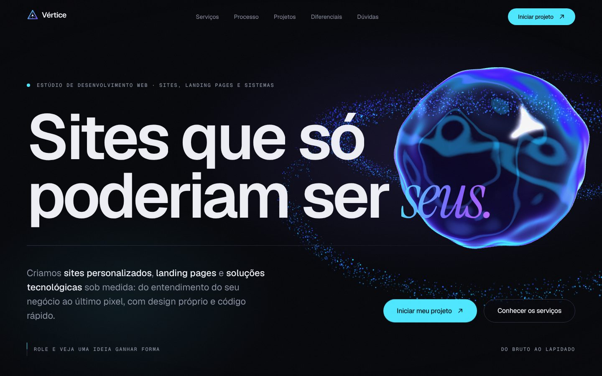

# Vértice — site de estúdio web

**Site no ar:** https://vertice-estudio-web.netlify.app



Site de um estúdio de desenvolvimento web que estou estruturando em dupla com um colega. Ainda é um projeto em fase inicial: o nome é provisório e o objetivo agora é aprender e validar a ideia.

**O que tem de interessante aqui**

- Cena 3D em Three.js com shaders GLSL próprios, que muda de posição conforme a seção da página
- Animações com GSAP + ScrollTrigger e rolagem suave com Lenis
- Formulário de briefing que monta a mensagem e abre a conversa no WhatsApp
- Next.js 15 com exportação estática, TypeScript e Tailwind CSS 4
- Todo o texto do site separado do layout, em `src/content/`, para editar sem mexer nos componentes

**Case no portfólio:** a landing page da Fcar Garage, estética automotiva de Santo André, feita sem custo para um negócio real em troca de poder usá-la como case.

**Como foi feito:** desenvolvido em dupla, com apoio de IA em partes do código, principalmente na cena 3D e nas animações.

---

## Documentação técnica

Next.js 15 (exportação estática) · TypeScript · Tailwind CSS 4 · Three.js · GSAP + ScrollTrigger · Lenis

---

## Rodar localmente no VS Code

**Pré-requisito (uma vez só):** instale o [Node.js LTS](https://nodejs.org) (versão 18.18 ou mais nova). Para conferir, abra um terminal e rode `node -v`.

1. No VS Code: **Arquivo → Abrir Pasta…** e escolha `D:\Sites\Empresa`.
2. Aceite instalar as **extensões recomendadas** quando o VS Code sugerir (Tailwind CSS IntelliSense e destaque de shaders).
3. Abra o terminal integrado: **Terminal → Novo Terminal** (atalho `` Ctrl+` ``).
4. Na primeira vez, instale as dependências:
   ```bash
   npm install
   ```
5. Inicie o site:
   ```bash
   npm run dev
   ```
6. Abra **http://localhost:3000** no navegador. Ao salvar qualquer arquivo, a página atualiza sozinha.

Para parar o servidor, clique no terminal e aperte `Ctrl+C`.

**Atalho:** em vez dos passos 5 e 6, aperte **F5** (ou vá em *Executar e Depurar → "Rodar o site (dev)"*). O VS Code inicia o servidor e abre o navegador sozinho.

### Outros comandos

| Comando | O que faz |
| --- | --- |
| `npm run dev` | Servidor de desenvolvimento com recarga automática |
| `npm run build` | Gera o site final na pasta `out/` |
| `npm run preview` | Mostra o resultado do build em http://localhost:4000 (rode `build` antes) |
| `npm run typecheck` | Verifica erros de TypeScript sem gerar o site |

### Publicar

Rode `npm run build` e envie **o conteúdo da pasta `out/`** para a hospedagem (Hostinger, cPanel, Netlify, Vercel, GitHub Pages etc.). É um site estático: não precisa de Node no servidor.

---

## Estrutura de pastas

```
public/                    Arquivos servidos como estão (imagens dos cases em public/projects/)
src/
├─ app/                    Página, layout, SEO (sitemap, robots, imagem de compartilhamento) e estilos globais
│  └─ globals.css          Tokens de design: cores, fontes, tamanhos, raios e animações (@theme)
├─ config/
│  └─ site.ts              Dados da agência: nome, WhatsApp, e-mail, redes, CNPJ, domínio
├─ content/                TODOS os textos do site, um arquivo por seção
│  ├─ navigation.ts        Links do menu
│  ├─ about.ts             Manifesto e princípios (Quem somos)
│  ├─ services.ts          Serviços
│  ├─ process.ts           Etapas do processo
│  ├─ projects.ts          Cases do portfólio
│  ├─ benefits.ts          Diferenciais
│  ├─ faq.ts               Perguntas frequentes
│  ├─ briefing.ts          Opções do formulário de orçamento
│  └─ marquee.ts           Faixa animada
├─ components/
│  ├─ layout/              Header e Footer
│  ├─ sections/            Uma seção da página por arquivo (Hero, Services, Process…)
│  ├─ forms/               Formulário de briefing e seus campos
│  ├─ ui/                  Peças reutilizáveis: Button, Logo, SplitText, TiltCard, Magnetic
│  ├─ visuals/             Microanimações dos cards de serviços e diferenciais
│  ├─ effects/             Cena 3D, cursor personalizado, barra de progresso
│  └─ providers/           Rolagem suave (Lenis) e direção da cena 3D por seção
├─ hooks/                  Hooks React compartilhados
└─ lib/
   ├─ motion.ts            GSAP, ScrollTrigger e utilitários de animação
   └─ scene/               Three.js: Experience (cena), shaders (GLSL) e state (estado animável)
```

### Regra prática: onde mexer

| Quero… | Arquivo |
| --- | --- |
| Trocar WhatsApp, e-mail, redes, CNPJ, domínio | `src/config/site.ts` |
| Mudar um texto | o arquivo da seção em `src/content/` |
| Adicionar um case | `src/content/projects.ts` + imagem em `public/projects/` |
| Mudar cores ou fontes | `src/app/globals.css` (bloco `@theme`) |
| Mudar o layout de uma seção | `src/components/sections/<Seção>.tsx` |
| Mudar onde o objeto 3D aparece em cada seção | `src/components/providers/SceneDirector.tsx` |
| Mudar o visual do objeto 3D | `src/lib/scene/` |
| Adicionar uma seção nova | crie em `components/sections/`, o texto em `content/` e inclua em `src/app/page.tsx` |

Campos vazios em `site.ts` (e-mail, redes, CNPJ, cidade) são ocultados automaticamente no site.

---

## Antes de publicar

1. Trocar `url` em `src/config/site.ts` pelo domínio real (usado em SEO, sitemap e Open Graph).
2. Revisar as respostas do FAQ (`src/content/faq.ts`) para refletirem a política real de preços, prazos e manutenção.
3. Trocar o nome provisório e o logo (`src/config/site.ts`, `src/components/ui/Logo.tsx` e `src/app/icon.svg`).
